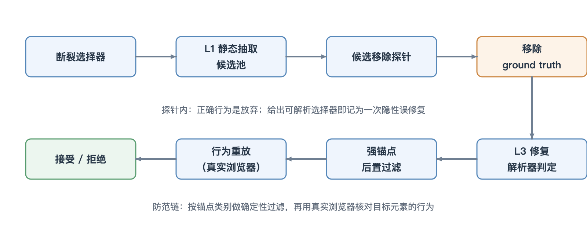

# Playwright 测试自愈隐性误修复检测与防范方法

高东彪
（软视软件（苏州）有限公司，江苏 苏州 215000）

**摘要：** 大语言模型驱动的 Playwright 测试自愈可能把测试改写到错误的元素上。针对这一问题，研究设计了一种基于候选移除探针的隐性误修复检测方法，并给出确定性后置过滤与行为重放验证相结合的防范思路。在 ReproBreak 数据集 koenig 项目的 75 个可达失效用例上，qwen2.5-coder:7b 的隐性误修复率为 78.7%，加入放弃提示后，逐用例判定结果没有变化；gpt-4o 与 deepseek-v4-flash 分别由 84.0%、80.0% 降至 68.0%、70.7%，仍有过半用例被改写成错误选择器。强锚点后置过滤带来零回归的局部改进，但收益随模型和候选分布变化。在 payloadcms/payload 的 319 个失效对上，静态可达率由 80.6% 降至 3.8%，主要原因是 BEM 风格的模板字符串类名。实验表明，仅靠提示文本难以形成可审计的安全边界，需要在模型之外增加确定性拒绝与行为重放验证。

**关键词：** 测试自愈；Playwright；大语言模型；隐性误修复；行为重放

## 1 概述

Playwright 测试对页面结构变化很敏感。一次 CSS 类名重命名、一次组件重新嵌套，或者一次不改变行为的事件处理函数重构，都可能让一批端到端测试找不到原来的元素。GUI 测试领域的研究把界面变更引起的脆弱性列为关键挑战[1-2]。常见的应对是测试自愈：定位器（locator）失效后，自动把它改写成指向新文档对象模型（Document Object Model，DOM）中“等价”元素的选择器。Healenium 依靠 DOM 相似度修复 Selenium 选择器。HealReact 则用可访问性树确定性地重新抽取元素，并在单个演示站点上报告了 100% 通过率[3]。近年来，大语言模型被用于缺陷检测、修复和模糊测试，定位器修复是其中较直接的一类应用[4-5]。

现有评测大多只检查补丁能否让测试重新通过，很少检查补丁是否指向开发者真正期望的元素。修复器只要找到一个能解析的 CSS 或 Playwright 选择器，测试就会“变绿”。如果这个选择器落到了相邻的按钮、标题或容器上，真实 UI 变更就被掩盖了。研究把这种情况称为隐性误修复。它不会报错，也不会让构建失败，因此比显性的测试失败更难发现。

围绕这一问题，研究做了三件事：一是设计候选移除探针，在 ReproBreak 数据集[6]的真实 React 代码库上测量隐性误修复率；二是比较本地 7B 模型与两个 API 模型在放弃提示下的表现；三是给出确定性后置过滤与行为重放验证的工程防范思路，并用第二个 React 项目检查方法的跨应用适应性。

## 2 检测方法与测量平台

### 2.1 候选移除探针

探针的思路很直接。对每一个可达的失效用例，先从候选集中删掉真实目标元素（ground truth），再让修复器在剩余候选里选。此时正确行为是放弃，即输出 CANDIDATE_IDX: -1。只要模型给出一个能解析的选择器，这个选择器就一定指向错误元素，记为一次隐性误修复。这样构造的好处是判定不依赖人工标注：选择器对应 LocatorSheet 中的哪条记录，由解析器确定，没有歧义。ground truth 取自 ReproBreak 的 new_locator 字段，经解析器映射到 LocatorSheet 中的元素。移除之后，模型没有任何合法答案可选。

实验使用 ReproBreak 中 koenig 项目的 75 个可达失效用例。ReproBreak 的 93 个失效目标里，有 18 个在静态层面无法到达。这 18 个用例既构造不出候选池，也无从判断修复器选得对不对，因此测量只覆盖其余用例。候选来自 L1 静态基底。修复器分别使用 qwen2.5-coder:7b[7]、gpt-4o 和 deepseek-v4-flash，temperature 均为 0。提示有两种：Vanilla（原始提示）与 L3 基线相同；Abstain 在同一提示后加一条“若无合适候选则放弃”的规则。两种提示共用同一候选集、同一解析器和同一判定标准。要求模型输出 SELECTOR、CANDIDATE_IDX 和 RATIONALE 三行纯文本。早期版本试过 JSON，但模型在 SELECTOR 字段里反复输出未转义的引号，解析经常失败，后来改成了纯文本。

### 2.2 L1/L3 静态基底

L1 层用 ts-morph 遍历 .tsx/.jsx 文件，为每个交互式 JSX 元素生成一条 LocatorSheet 记录，字段包括标签、父链、role、data-testid、aria-label、id、className 以及任意 data-* 属性。抽取器把带有稳定锚点的元素都视为可交互元素，而不只检查标准 HTML 标签。在 koenig 上，这一改动把锚点覆盖率从 22% 提高到 48%，解析器命中率从 0 提高到 71%。每个提交（commit）平均得到约 400 条记录，静态层面能到达 93 个真实失效目标中的 75 个，可达率 80.6%。

L3 层在 L1 产出的候选上调用代码模型。候选按 token 重叠打分检索，testId 权重为 3，data 属性为 2，aria/id/class/text/path 为 1。解析器把模型给出的选择器与 LocatorSheet 记录做匹配，以此判断它是精确命中、误修复还是无法解析。解析器要处理三类情况：带引号的嵌套参数、属性值里的动态 JS 表达式，以及裸属性选择器。早期版本曾因解析缺陷把可达率虚抬到 85%–98%，修正后统一采用 80.6% 这一较保守的数字。

各项指标都在选择器解析层面计算：可达率是失效的选择器能否解析到某条记录；top-1 精确匹配是修复后的选择器与 ground truth 是否落到同一条记录；隐性误修复率是在目标被移除的用例中，模型给出可解析但错误选择器的比例。它们不是端到端 Playwright 通过率。检测与防范的总体流程如图 1 所示。

## 3 实验与结果

### 3.1 三种模型的误修复率

表 1 给出 75 个可达用例上的结果。qwen2.5-coder:7b 在 Vanilla 提示下，有 59 个用例给出错误但可解析的选择器，误修复率 78.7%；13 个用例放弃，3 个无法解析。加上放弃规则后，三个数字都没有变化，逐用例对比也完全一致，可见这个 7B 模型没有把“必要时放弃”的提示转化为可观察的行为。78.7% 是在目标被强制移除的对抗性条件下得到的上界，不是日常部署中的误修复率。

**表 1 候选移除探针下三种模型的误修复率**

| 模型 | 提示 | 误修复用例数 | 误修复率 |
| --- | --- | --- | --- |
| qwen2.5-coder:7b | Vanilla | 59 | 78.7% |
| qwen2.5-coder:7b | Abstain | 59 | 78.7% |
| gpt-4o | Vanilla | 63 | 84.0% |
| gpt-4o | Abstain | 51 | 68.0% |
| deepseek-v4-flash | Vanilla | 60 | 80.0% |
| deepseek-v4-flash | Abstain | 53 | 70.7% |

注：分母均为 75 个可达用例。

两个 API 模型的反应不同。gpt-4o 从 63/75（84.0%）降到 51/75（68.0%），deepseek-v4-flash 从 60/75（80.0%）降到 53/75（70.7%）。逐用例看，gpt-4o 有 12 个原本误修复的用例改成了放弃，deepseek-v4-flash 有 8 个改成放弃，另有 1 个原本无法解析的用例转为误修复。McNemar 精确检验的 p 值分别为 0.0005 和 0.039，说明放弃提示确实起了作用。但两个模型仍有过半用例输出错误但可解析的选择器。一种可能的解释是，模型越强，越能在“生成看似合理的答案”和“承认没有答案”之间权衡，但后者始终没有确定性保证。Qwen 为什么完全不响应，研究没有做消融实验来分离原因。一个合理的猜测是，7B 模型在正确候选项被删除后，仍会从剩余候选里挑一个最接近的；放弃规则要求它先承认“没有答案”，这一步对该模型偏难。

### 3.2 后置过滤的有限收益

在 L3 基线上，研究比较了两个低开销的确定性手段：testId 加权检索和强锚点后置过滤。Qwen 上两个手段全开时，top-1 精确匹配从 55/75（73.3%）提高到 58/75（77.3%），新增 3 个正确用例，没有回归。单独开启任一手段都是 +2/-0，同时开启为 +3/-0，McNemar 检验的 p 值均不低于 0.25。DeepSeek 上的结果更集中：基线为 68/75（90.7%）；仅开后置过滤为 72/75（96.0%，+4/-0）；仅开 testId 加权仍为 68/75（+5/-5），净增为零；两者同开反而低于仅开过滤。所有差异在 n=75 下都没有达到统计显著水平。表 2 汇总了静态基底与后置过滤的主要数字。

如果按完整的 93 个失效目标计算，把不可达用例一并计入分母，两个手段全开的 top-1 精确匹配从 59.1% 升到 62.4%。77.3% 描述的只是工具在“看得见”的目标里的表现，这两个数字应当分开使用。

**表 2 静态基底与确定性手段的主要结果**

| 指标 | 设置 | 结果 |
| --- | --- | --- |
| L1 静态可达率（koenig） | 宽松解析 | 75/93（80.6%） |
| L1 静态可达率（koenig） | 收紧解析 | 51/93（54.8%） |
| L1 静态可达率（payload） | 宽松解析 | 12/319（3.8%） |
| L3 top-1 精确匹配 | qwen，未开启 | 55/75（73.3%） |
| L3 top-1 精确匹配 | qwen，全开 | 58/75（77.3%） |
| L3 top-1 精确匹配 | deepseek，未开启 | 68/75（90.7%） |
| L3 top-1 精确匹配 | deepseek，仅过滤 | 72/75（96.0%） |
| L3 top-1 精确匹配 | deepseek，仅加权 | 68/75（90.7%） |
| L3 top-1 精确匹配 | deepseek，全开 | 69/75（92.0%） |

注：L3 指标以 75 个可达用例为分母；L1 可达率以各项目的失效目标总数为分母。

因此，研究把后置过滤看作一种低开销、零回归的工程手段，而不是已被统计验证的性能提升。它不依赖模型偏好，只按锚点类别做输出约束。加权检索则会重排候选，收益随底层模型和候选分布变化。DeepSeek 上的结果说明，后置过滤的可迁移性比 testId 加权更好：加权会改变候选顺序，而过滤已经剔除弱锚点，重排不再带来稳定收益。

### 3.3 跨应用的可达率下降

为了检查方法是否只在 koenig 上成立，研究在 payloadcms/payload 上运行了未修改的 L1 抽取器。payload 是 ReproBreak 中第二大的 Playwright 案例组，包含 319 个失效对。在 HEAD 版本上，抽取器得到 457 条记录；ReproBreak 标注的 319 个新定位器中，只有 12 个能被静态解析，即 3.8%；koenig 是 75/93，即 80.6%。80.6% 是宽松解析器假设下的上界，收紧假设后会降到 54.8%。payload 的 457 条是 HEAD 单次抽取的结果，koenig 的约 400 条是每个提交的平均值。

下降的原因在锚点约定，不在抽取器本身。payload 使用 BEM：组件先声明 const baseClass = 'dashboard'，再用模板字符串拼出 className={`${baseClass}__add-button`}。测试引用的是渲染后的 .dashboard__add-button，而只识别字面量类名的 AST 抽取器看不到这个类名。研究对未命中的 307 个用例做了非系统抽样，看到的都是同一类问题。

这一结果暴露的是一处范围明确的盲区，L1 的设计本身并未被否证。跨应用泛化的第一道关卡很可能在锚点约定这一层。一个只在单一应用上测过的修复工具，很容易高估自己的适用范围。

工程团队在引入自愈工具前，应先统计自己代码库的锚点写法：data-testid 占多少，className 是静态字符串还是模板拼接，组件库有没有封装测试属性。锚点越接近静态字面量，L1 这类方法的覆盖越高；如果大量使用 BEM 或 CSS Modules，就需要先补展开器，否则工具会把大批用例判为不可达。回溯 baseClass 常量、展开模板字符串，再补一个处理 CSS Modules 的等价展开器，是确定性的修复方向，研究留作后续工作。

## 4 工程防范建议

把上述结果放回持续集成（Continuous Integration，CI）场景，最直接的建议是不要自动合并大语言模型提出的选择器补丁。修复器让构建失败并不可怕，测试本来就该在 UI 变更时失败。危险的是它让构建通过，而通过的却是错误的目标。

一层防线是确定性后置过滤：优先保留 data-testid、data-kg-* 这类强锚点，弱锚点候选只在没有强锚点时使用。这个手段开销低，不改变模型，也不依赖提示，适合放在补丁生成和合并之间。另一层是行为重放：在真实浏览器里重放打过补丁的测试，比较目标元素的可见文本、role、可交互性和网络请求。如果补丁指向的元素与失败前的行为不一致，就拒绝。研究没有实现完整的重放验证器，只在 3 个静态精确匹配用例（编号 615、702、703）上做了 Docker 重放，其中 615 和 703 通过，702 因等待 color-picker-toggle 超时失败。这个样本很小，只能说明静态匹配与运行时结果之间确实存在差距：静态精确匹配有的能复现到运行时，有的会因可见性、时序或上下文差异而失败。

候选移除探针本身也可以作为自愈工具的回归测试。更换模型、调整提示或修改检索权重后，在一个固定的可达用例集上跑一遍探针，比较误修复率，就能看出改动是否只是把错误答案换了个写法。这项检查不需要人工标注，适合跟着模型升级周期定期执行。它不替代行为重放，但成本更低，能在早期拦住明显退化的版本。

在无人值守流水线里，比较稳妥的做法是把 LLM 补丁当作候选，经过后置过滤和行为重放，再由人确认是否合并。把 78.7% 与 18/93 的不可达比例相乘，可以得到约 15% 的粗略风险上界。这不是实际部署中的实测值，但足以说明为什么不能只看“测试是否变绿”。

## 5 结语

研究用候选移除探针测量了大语言模型测试自愈的隐性误修复。结果表明，本地 7B 模型对放弃提示不敏感，两个 API 模型能部分响应，但仍有过半错误补丁可解析。确定性后置过滤能带来零回归的局部改进，跨应用的可达率则受锚点写法制约。无人值守 CI 中，更可靠的路线是在模型之外增加确定性拒绝和行为重放验证，而不是继续加长提示词。后续工作包括把运行时 DOM 捕获和行为重放接入流水线，并在更多 React 项目上验证锚点写法的分布。

## 参考文献

[1] 李聪, 蒋炎岩, 许畅. 基于GUI事件的安卓应用录制重放关键技术综述[J]. 软件学报, 2022, 33(5): 1612-1634.

[2] 王博, 陈冲, 邓明, 等. 移动应用GUI测试自动生成技术综述[J]. 软件学报, 2025, 36(6): 2713-2746.

[3] JOSEPH R N. Beyond LLM-based test automation: a zero-cost self-healing approach using DOM accessibility tree extraction[EB/OL]. arXiv:2603.20358, 2026[2026-06-20]. https://arxiv.org/abs/2603.20358.

[4] 香佳宏, 徐霄阳, 孔繁初, 等. 大模型在软件缺陷检测与修复的应用发展综述[J]. 软件学报, 2025, 36(4): 1489-1529.

[5] 李斌, 贺也平, 马恒太. 程序自动修复: 关键问题及技术[J]. 软件学报, 2019, 30(2): 244-265.

[6] DE MOURA T S, ADAMIETZ L, MEHBOOB S, et al. ReproBreak: a dataset of reproducible web locator breaks[EB/OL]. arXiv:2605.12158, 2026[2026-06-20]. https://arxiv.org/abs/2605.12158.

[7] HUI B, YANG J, CUI Z, et al. Qwen2.5-Coder technical report[EB/OL]. arXiv:2409.12186, 2024[2026-06-20]. https://arxiv.org/abs/2409.12186.

**作者简介：** 高东彪（1986—），男，工程师，学士，研究方向为 AI 在软件测试中的应用。
